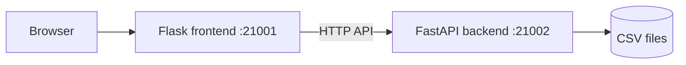

# Leaf & Lore — Docker Image Optimization

A Python bookstore application used to explore how Docker base images, multi-stage builds, and dependency management affect container image size.

The main focus is the **backend image optimization process**: seven Dockerfiles, each introducing a specific change. A Flask frontend and Docker Compose configuration are included to run the complete application.

## Application overview

Leaf & Lore has two Python services:

- **Backend:** FastAPI service for managing books, backed by CSV storage.
- **Frontend:** Flask web interface that communicates with the backend over HTTP.

Both projects use **uv** for Python dependency management. The container images are built with Python 3.13.



## Tech stack

| Component | Technology |
| --- | --- |
| Backend API | Python 3.13, FastAPI |
| Frontend | Python 3.13, Flask |
| Data storage | CSV files |
| Dependency management | uv |
| Containerization | Docker, Docker Compose |
| Image scanning | Trivy |

**Prerequisites:**

- Git
- Python 3.13
- uv
- Docker & Docker Compose
- Trivy

## Backend image optimization

The backend Dockerfiles are in [`src/backend/`](src/backend/). The goal is to demonstrate how Docker image size can be gradually reduced through a series of optimization techniques.

| Image | Dockerfile | Change |
| --- | --- | --- |
| `backend:00` | [`Dockerfile.full`](src/backend/Dockerfile.full) | Full Python base image |
| `backend:01` | [`Dockerfile.slim`](src/backend/Dockerfile.slim) | Debian-based Slim image |
| `backend:02` | [`Dockerfile.alpine`](src/backend/Dockerfile.alpine) | Alpine Linux base image |
| `backend:03` | [`Dockerfile.multistage-slim`](src/backend/Dockerfile.multistage-slim) | Multi-stage Slim build |
| `backend:04` | [`Dockerfile.multistage-alpine`](src/backend/Dockerfile.multistage-alpine) | Multi-stage Alpine build |
| `backend:05` | [`Dockerfile.multistage-alpine-nonroot`](src/backend/Dockerfile.multistage-alpine-nonroot) | Non-root execution |
| `backend:06` | [`Dockerfile.multistage-alpine-nonroot-nodev`](src/backend/Dockerfile.multistage-alpine-nonroot-nodev) | Exclude development dependencies |

## Build the backend images

From the repository root, with Docker installed:

```bash
docker build -f src/backend/Dockerfile.full -t backend:00 src/backend
docker build -f src/backend/Dockerfile.slim -t backend:01 src/backend
docker build -f src/backend/Dockerfile.alpine -t backend:02 src/backend
docker build -f src/backend/Dockerfile.multistage-slim -t backend:03 src/backend
docker build -f src/backend/Dockerfile.multistage-alpine -t backend:04 src/backend
docker build -f src/backend/Dockerfile.multistage-alpine-nonroot -t backend:05 src/backend
docker build -f src/backend/Dockerfile.multistage-alpine-nonroot-nodev -t backend:06 src/backend
```

Inspect the resulting images:

```bash
docker image ls backend
docker history backend:06
```

Verify the runtime user in the image:

```bash
docker run --rm --entrypoint id backend:05
```

Should report UID 1000 rather than root.

Scan images with [Trivy](https://trivy.dev/):

```bash
trivy image --scanners vuln,secret --severity HIGH,CRITICAL backend:06
```

## Frontend image

The Flask frontend has one Dockerfile: [`src/frontend/Dockerfile.frontend`](src/frontend/Dockerfile.frontend). It uses a multi-stage Alpine Docker build to reduce image size. It installs only the dependencies needed to run the application and runs as a non-root user (app-user) on port 21001.

```bash
docker build -f src/frontend/Dockerfile.frontend -t bookstore-frontend:01 src/frontend
```

Reaches FastAPI through `API_URL=http://backend:21002`.

## Run the application with Docker Compose

[`compose.yaml`](compose.yaml) to builds and starts both services together.

```bash
docker compose config
docker compose up -d --build
docker compose ps
```

| Service | Address |
| --- | --- |
| Bookstore frontend | <http://localhost:21001> |
| Backend API | <http://localhost:21002> |
| FastAPI documentation | <http://localhost:21002/docs> |

View logs or stop the stack:

```bash
docker compose logs -f backend frontend
docker compose down
```
