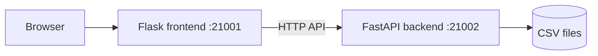

# Leaf & Lore — Docker Image Optimization

A Python bookstore application used to explore how Docker base images, multi-stage builds, dependency management, and runtime permissions affect container images.

The main focus is the **backend image optimization process**: seven Dockerfiles, each introducing a specific change. A Flask frontend and Docker Compose configuration are included to run the complete application.

## Application overview

Leaf & Lore has two Python services:

- **Backend:** FastAPI service for managing books, backed by CSV storage.
- **Frontend:** Flask web interface that communicates with the backend over HTTP.

Both projects use **uv** for Python dependency management. The container images are built with Python 3.13.



## Tech stack

| Component | Technology |
|---|---|
| Backend API | Python 3.13, FastAPI |
| Frontend | Python 3.13, Flask |
| Data storage | CSV files |
| Dependency management | uv |
| Containerization | Docker, Docker Compose |
| Image scanning | Trivy |

**Requirements:** Docker with the Compose plugin is needed to run the application. Git is useful for cloning the repository; Trivy is optional for security scans. You don't need a local Python installation to run the containers.

## Backend image optimization

The backend Dockerfiles are in [`src/backend/`](src/backend/). The goal is to compare changes individually rather than combine every optimization into the first build.

| Image | Dockerfile | Change introduced |
|---|---|---|
| `backend:00` | [`Dockerfile.full`](src/backend/Dockerfile.full) | Full Python image as the baseline |
| `backend:01` | [`Dockerfile.slim`](src/backend/Dockerfile.slim) | Switch to the smaller Debian-based Slim image |
| `backend:02` | [`Dockerfile.alpine`](src/backend/Dockerfile.alpine) | Compare Alpine against the Debian-based images |
| `backend:03` | [`Dockerfile.multistage-slim`](src/backend/Dockerfile.multistage-slim) | Separate dependency building from the Slim runtime |
| `backend:04` | [`Dockerfile.multistage-alpine`](src/backend/Dockerfile.multistage-alpine) | Use a multi-stage build with Alpine |
| `backend:05` | [`Dockerfile.multistage-alpine-nonroot`](src/backend/Dockerfile.multistage-alpine-nonroot) | Run the API as a non-root user |
| `backend:06` | [`Dockerfile.multistage-alpine-nonroot-nodev`](src/backend/Dockerfile.multistage-alpine-nonroot-nodev) | Exclude development dependencies from the final build |

## Build the backend images

From the repository root, with Docker installed:

```bash
docker build -f src/backend/Dockerfile.full -t backend:00 src/backend
docker build -f src/backend/Dockerfile.slim -t backend:01 src/backend
docker build -f src/backend/Dockerfile.alpine -t backend:02 src/backend
docker build -f src/backend/Dockerfile.multistage-slim -t backend:03 src/backend
docker build -f src/backend/Dockerfile.multistage-alpine -t backend:04 src/backend
docker build -f src/backend/Dockerfile.multistage-alpine-nonroot -t backend:05 src/backend
docker build -f src/backend/Dockerfile.multistage-alpine-nonroot-nodev -t backend:06 src/backend
```

Inspect the resulting images:

```bash
docker image ls backend
docker history backend:06
```

Verify the runtime user in the last two images:

```bash
docker run --rm --entrypoint id backend:05
docker run --rm --entrypoint id backend:06
```

Both should report UID 1000 rather than root.

## Comparing the results

I evaluate each build using four criteria:

| Metric | Why it matters | How to check |
|---|---|---|
| Image size | Registry storage and image transfer cost | `docker image ls backend` |
| Build time | Impact on local development and CI builds | `time docker build ...` |
| Vulnerabilities | Known issues in OS and installed packages | Trivy |
| Runtime behavior | Whether the optimized image still runs correctly | Start the API and test `/health` |

Scan any image with [Trivy](https://trivy.dev/):

```bash
trivy image --scanners vuln,secret --severity HIGH,CRITICAL backend:06
```

For a useful comparison, build each image on the same machine and architecture, record the same measurements, and scan with consistent Trivy settings. Actual benchmark numbers are intentionally not included until measured.

## Frontend image

The Flask frontend has one Dockerfile: [`src/frontend/Dockerfile.frontend`](src/frontend/Dockerfile.frontend). It uses a multi-stage Alpine build, installs dependencies without the development group, and runs as `app-user` on port `21001`.

```bash
docker build -f src/frontend/Dockerfile.frontend -t bookstore-frontend:01 src/frontend
```

Its entry point is `book-store-frontend`. In the combined setup, it reaches FastAPI through `API_URL=http://backend:21002`.

## Run the application with Docker Compose

Once the individual images have been reviewed, [`compose.yaml`](compose.yaml) builds and starts both services together.

```bash
docker compose config
docker compose up -d --build
docker compose ps
```

| Service | Address |
|---|---|
| Bookstore frontend | http://localhost:21001 |
| Backend API | http://localhost:21002 |
| FastAPI documentation | http://localhost:21002/docs |

View logs or stop the stack:

```bash
docker compose logs -f backend frontend
docker compose down
```
